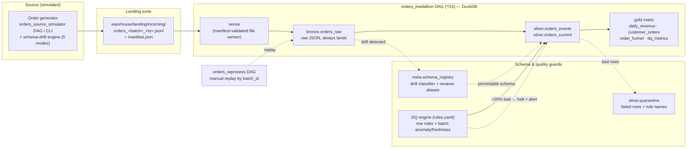

# orders-pipeline

Medallion-architecture data pipeline: a simulated e-commerce source system
emits order batches every 15 minutes (with schema drift), and an Airflow
pipeline lands them in DuckDB through bronze → silver → gold with schema
evolution, data quality gates, and quarantine.

## Architecture



## What makes this different (USP)

- **Drift is a first-class citizen, not a failure mode.** Most demo pipelines
  break the moment the source changes shape. Here a drift *engine* deliberately
  mutates the schema (add / remove / type change / rename / nested) and the
  pipeline absorbs it: bronze always lands, a schema registry classifies the
  drift, additive columns flow to `extras`, and renames are healed with an
  alias + replay — no code change, no lost data.
- **Nothing is ever dropped silently.** Bad rows are quarantined *with the rule
  names that failed*; a batch that's >20% bad halts before polluting silver and
  raises an alert. You can always answer "where did that record go?"
- **Replayable by design.** Every layer is idempotent (delete-then-insert by
  `batch_id`, rebuildable `orders_current` and gold marts), so any batch can be
  reprocessed at any time via a dedicated `orders_reprocess` DAG.
- **Airflow-optional core.** All pipeline logic lives in plain Python
  (`pipeline/run.py`); the DAGs are thin wrappers. The same code runs in a
  unit test, a laptop demo (`python -m pipeline.run`), or a scheduler.
- **Proven, not promised** — 124 unit + integration tests cover the drift
  classifier, DQ rules, casting, idempotency, halt threshold, and an E2E smoke.

## Layout

- `generator/` — order simulator + schema drift engine (5 drift modes: add,
  remove, type change, rename, nested). State persists in
  `warehouse/generator_state.json` so drift accumulates across runs.
- `pipeline/` — Airflow-agnostic pipeline logic. `run.py` holds the task
  entry points; `warehouse.py` owns all DDL.
- `dq/` — YAML rule spec (`rules.yaml`) + rule engine. Row rules quarantine;
  batch rules (volume anomaly, freshness) alert.
- `dags/` — thin wrappers: `orders_source_simulator`, `orders_medallion`,
  `orders_reprocess` (manual replay by batch_id).
- `tests/` — 124 tests: unit (generator, classifier, DQ rules, casting) +
  integration (file edge cases, idempotency, halt threshold, E2E smoke).
- `viz/` — Streamlit dashboard over the gold marts. `queries.py` holds pure
  `con -> DataFrame` functions (unit-tested like the pipeline); `app.py` renders
  four panels; `theme.py` carries a colorblind-validated palette. Opens DuckDB
  **read-only** so it never contends with a running pipeline pass.

## Key behaviors

- **Bronze always succeeds** — records land as raw JSON regardless of drift;
  silver decides what's promotable.
- **Idempotent everywhere** — delete-then-insert by `batch_id` (bronze,
  silver), `orders_current` rebuilt from event history, gold marts rebuilt
  from silver. Any task can be retried or replayed safely.
- **Quarantine-and-continue** — bad rows go to `silver.quarantine` with the
  failed rule names; a batch with >20% bad rows halts (promotes nothing) and
  alerts.
- **Schema evolution** — additive columns flow to `extras` JSON automatically;
  renames are healed by registering an alias
  (`schema_registry.register_alias(con, "cust_id", "customer_id")`) and
  replaying the batch via the `orders_reprocess` DAG.

## Run it

```bash
python3 -m venv .venv && .venv/bin/pip install -r requirements.txt

# generate a few batches (force drift to see evolution)
.venv/bin/python -m generator.generate --rows 60
.venv/bin/python -m generator.generate --force-drift add_column

# run one full pipeline pass without Airflow
.venv/bin/python -m pipeline.run

# tests
.venv/bin/python -m pytest tests/ -q

# dashboard (reads the gold marts read-only)
.venv/bin/streamlit run viz/app.py

# with Airflow (dags/ as your DAG folder)
export AIRFLOW_HOME=... ; airflow standalone
```

Fast E2E mode for demos: `.venv/bin/python -m generator.generate --loop --interval 5`.
