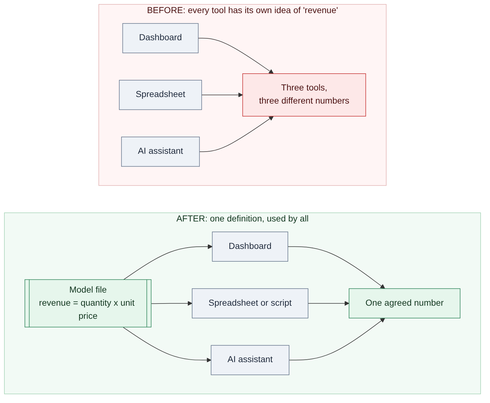
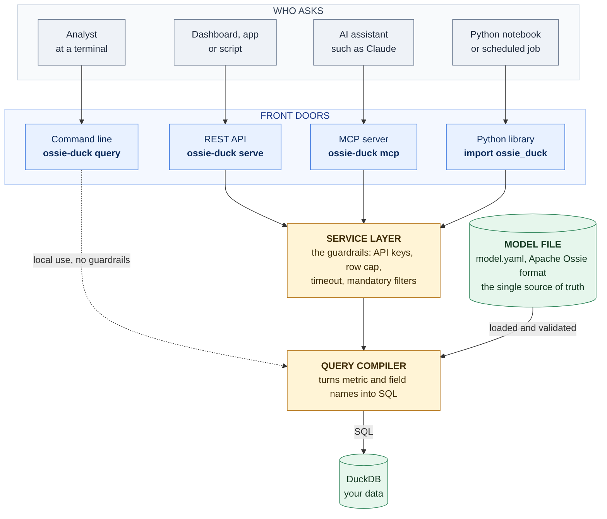

# Define your metrics once: a semantic layer with Apache Ossie and DuckDB

*Publishing notes (delete before posting): upload `docs/blog-1-same-metric-everywhere.png` as the cover image and `docs/blog-2-architecture.png` where marked. A short LinkedIn teaser is at the bottom of this file.*

---

Ask three colleagues for "last quarter's revenue" and you can get three different numbers.

One included tax. One left out refunds. One counted only paid orders. Nobody was wrong, exactly. Each of them was using a slightly different definition, buried in a different dashboard, spreadsheet or SQL query. The next meeting is then spent arguing about whose number is right instead of what to do about it.

Now add an AI assistant. You ask it the same question in plain English, and it writes its own SQL with its own idea of what "revenue" means. That makes four numbers.

I wanted to see what it takes to fix this properly, so I built a small project over a weekend: **ossie-duck**.



## The idea: write the definition down once

The fix has a name: a **semantic layer**. It's a file where you say, once, what your business terms mean. "Revenue is quantity times unit price." "An active customer is one with an order in the period." Every tool then asks that file what the words mean, instead of making up its own answer.

What makes this exciting now is that there's an open standard for such files: **Apache Ossie** (formerly the Open Semantic Interchange). It defines a vendor-neutral, YAML-based format for datasets, relationships and metrics, so a definition written once can in principle travel between tools.

A standard is only useful if something reads it, so I built a small engine that does. It reads an Ossie model and answers questions from it, running on [DuckDB](https://duckdb.org), a fast analytical database that runs on a laptop with nothing to install.

## What it does

You ask for things by name, not by SQL:

```bash
ossie-duck query coffee_shop_model.yaml --db coffee_shop.duckdb \
    -m revenue -d customers.country --order revenue:desc
```

```
country  revenue
-------  -------
India     231.25
UK        184.75
USA       172.25
Germany   100.00
(4 rows)
```

You never said which tables to use, how to join orders to customers, or what "revenue" is. The model knew all three. The tool read it, worked out the join, wrote the SQL and ran it.

The same model is available through four "front doors":

- a **command line** for analysts;
- a **REST API** for dashboards and apps;
- an **MCP server**, so AI assistants like Claude can use it;
- a **Python library** for notebooks and scheduled jobs.



Four ways in, one source of truth. A person at a terminal, a dashboard and an AI assistant all go through the same compiler and the same definitions.

## The demo that sold it to me

The project includes a tiny coffee-shop dataset: 8 customers, 24 orders. Revenue by country comes to 688.25 in total.

Now I open the model file and change one line, so that revenue no longer counts mugs:

```yaml
expression: { sql: "SUM(CASE WHEN orders.product <> 'Ceramic Mug' THEN orders.line_total ELSE 0 END)" }
```

I rerun the same command, and India drops from 231.25 to 219.25. UK, USA and Germany change too. I didn't touch the query, the dashboard code or any prompt. Every front door shows the new answer, because they all read the same definition.

That's the whole point of the project. It's the difference between "we should align on this metric" and the metric actually being aligned.

## Why I'm comfortable letting an AI use it

The MCP server is where it gets interesting for AI. A common worry is that an assistant writing SQL against your database might get it wrong, run something expensive, or touch data it shouldn't.

Here, **the AI never writes SQL.** It sees a catalog of metric and field names, descriptions and synonyms. It replies with something like "metric `revenue`, grouped by `customers.country`", and the compiler builds the SQL. A mistyped name gets a "did you mean…" error, not a made-up answer.

For anything that's exposed over a network, a service layer adds guardrails:

- **API keys** are required, and the server refuses to listen on a non-local address without them.
- **Row caps** limit how much any request can return.
- **Timeouts** cancel runaway queries.
- **Mandatory base filters** are added to every query. For example, a team can be limited to `store.s_state = 'CA'`.
- **Filters are allow-listed.** Only simple comparisons are accepted, not arbitrary SQL fragments.

None of this makes it production-ready on its own. It does mean the safe path is also the easy one.

## What I learned

**Most of the engineering is in the unglamorous parts.** The core idea, turning names into joins and SQL, fits in a small compiler. Most of the work went into the edges: validating the model with helpful messages, refusing ambiguous questions instead of guessing, and making error messages tell a newcomer what to do next.

**Tests earned their keep.** The project has 180 automated tests, many of which compare results with hand-written SQL. They caught real bugs, including a query-timeout test that was itself too heavy and filled the disk of my sandbox. I replaced it with a streaming test that runs in a fraction of a second.

**The AI tooling is moving fast.** The MCP SDK I used had renamed its main class between major versions, and its default behaviour hides tool error messages from the model. I had to map expected errors explicitly so the assistant would see "did you mean `revenue`?" instead of a generic failure.

**I built this with Claude**, working through the design, code, tests and documentation in one long session. What worked was treating it like a pair programmer: I steered the scope, and every claim in the README got checked by running the README's own commands in a fresh environment.

## Honest limitations

This is a learning project, not a product. It implements a **draft** version of the spec (`0.2.0.dev0`), supports one fact table per question, and hasn't been load-tested. For real production use, look at the official Apache Ossie tooling first. And it's an independent project, not affiliated with or endorsed by the Apache Software Foundation.

## Try it

It takes about five minutes, and you need nothing but Python 3.10+ and git:

```bash
git clone https://github.com/mani-bellan/claude-projects.git
cd claude-projects/ossie-duck
python -m venv .venv && source .venv/bin/activate
pip install -e ".[all]"
ossie-duck demo
```

The README has a hands-on coffee-shop walkthrough, six architecture diagrams, and instructions for connecting an AI assistant. The code is here: **https://github.com/mani-bellan/claude-projects/tree/main/ossie-duck**

If your team has ever argued about whose number is right, I'd like to hear how you handle metric definitions today. A semantic layer, a wiki, tribal knowledge, or just hoping for the best?

---

## LinkedIn teaser (paste as the post text, link the blog or repo in the first comment)

Ask three colleagues for "last quarter's revenue" and you can get three different numbers. Add an AI assistant that writes its own SQL, and you get four.

Over a weekend I built **ossie-duck**: write what "revenue" means once, in an open Apache Ossie model file, and every tool reads that same definition: a command line, a REST API, Python, and AI assistants through MCP.

The part I like most: the AI never writes SQL. It picks metric names, and a compiler builds the query, with API keys, row caps, timeouts and mandatory filters around it.

Change one line in the model, and every tool shows the new number.

It's a learning project (draft spec, one fact table per question), with 180 tests and a README with architecture diagrams for technical and non-technical readers.

Code and write-up: https://github.com/mani-bellan/claude-projects/tree/main/ossie-duck

How does your team keep metric definitions consistent?

#DataEngineering #SemanticLayer #DuckDB #ApacheOssie #MCP #Python
