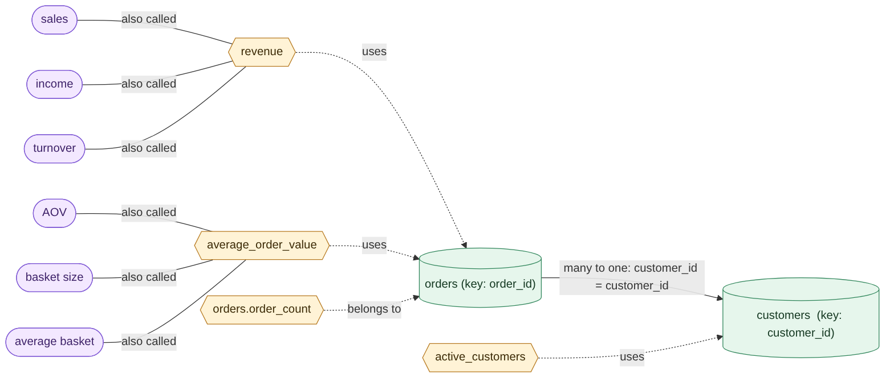
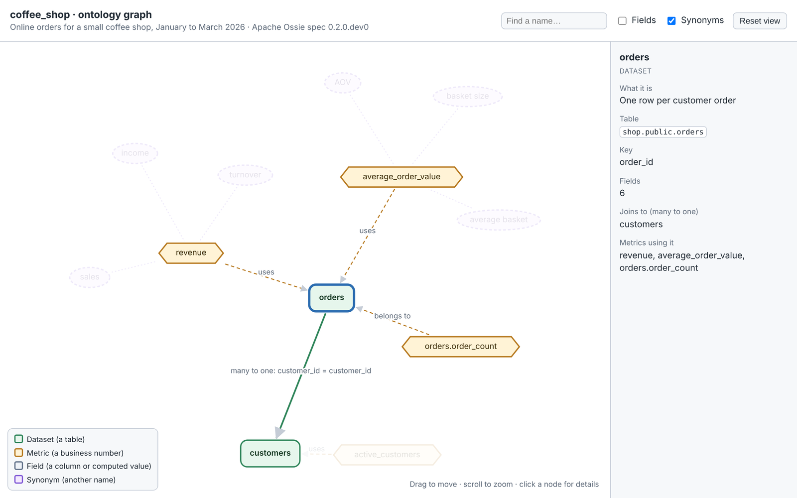
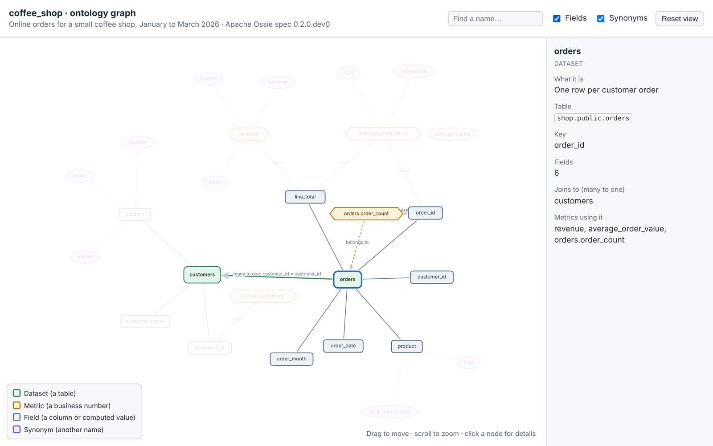
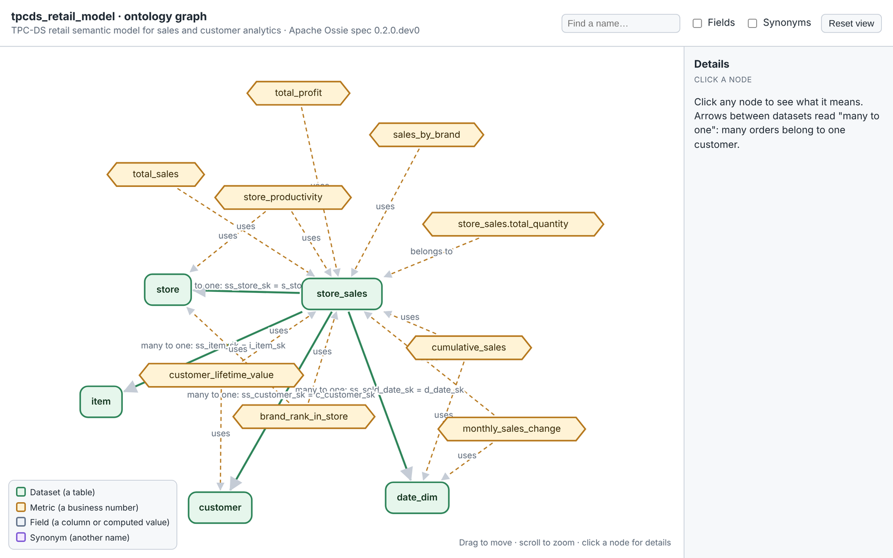

# Define your metrics once: what Apache Ossie can do, shown with a working engine on DuckDB

Ask three colleagues for "last quarter's revenue" and you can get three different numbers.

One included tax. One left out refunds. One counted only paid orders. Nobody was wrong, exactly. Each of them was using a slightly different definition, buried in a different dashboard, spreadsheet or SQL query. The next meeting is then spent arguing about whose number is right instead of what to do about it.

Now add an AI assistant. You ask it the same question in plain English, and it writes its own SQL with its own idea of what "revenue" means. That makes four numbers.

There's an open standard aimed at exactly this problem: **Apache Ossie**. To understand what it can really do, I didn't want to read the spec. I wanted to use it. So over a weekend I built **ossie-duck**, a small engine whose whole purpose is to show Ossie's capabilities working end to end: take an Ossie model file, and answer real questions from it.


## The idea: write the definition down once

The fix has a name: a **semantic layer**. It's a file where you say, once, what your business terms mean. "Revenue is quantity times unit price." "An active customer is one with an order in the period." Every tool then asks that file what the words mean, instead of making up its own answer.

**Apache Ossie** (formerly the Open Semantic Interchange) is an open, vendor-neutral standard for writing that file. Its promise is portability: a definition written once, in one format, can be read by any tool that understands the standard, instead of being locked inside one BI product. Ossie is still an incubating Apache project, and the version I built against (`0.2.0.dev0`) is a draft.

A standard is only as useful as the things that read it. So the question this project answers is: **what does an Ossie model actually let a tool do?**

## What's inside an Ossie model

An Ossie model is a plain YAML file. Here is a trimmed-down version of the coffee-shop model that ships with the project:

```yaml
version: "0.2.0.dev0"
name: coffee_shop
ai_context:
  instructions: "Revenue is quantity times unit price, before tax."

datasets:
  - name: orders
    source: shop.public.orders
    primary_key: [order_id]
    fields:
      - name: line_total
        expression: { sql: quantity * unit_price }
        description: Money for this order, before tax
      - name: order_month
        expression:
          dialects:
            - dialect: DUCKDB
              expression: "strftime(order_date, '%Y-%m')"
        dimension: { is_time: true }
  - name: customers
    source: shop.public.customers
    fields:
      - name: country
        expression: { sql: country }
        ai_context:
          synonyms: ["market", "region", "location"]

relationships:
  - name: orders_to_customers
    from: orders
    to: customers
    from_columns: [customer_id]
    to_columns: [customer_id]

metrics:
  - name: revenue
    expression: { sql: SUM(orders.line_total) }
    description: Total money earned from orders, before tax
    ai_context:
      synonyms: ["sales", "income", "turnover"]
```

That's all it takes to describe a small business. Each part of the file is a capability, and each one is something ossie-duck puts to work:

| What the Ossie model contains | What it means | How ossie-duck uses it |
|---|---|---|
| **Datasets and fields** | The tables, and the columns or computed values in them | Each dataset becomes a building block of the query. Only the fields a question needs are pulled in. |
| **Relationships** | "Many orders belong to one customer," and which columns link them | The engine works out the joins itself, so nobody writes `JOIN` by hand. It also warns when a join could double-count. |
| **Metrics** | Named business calculations, defined once, either for the whole model or for one dataset | "Revenue" and "average order value" are looked up by name and used as written, never reinvented. |
| **Dialects** | The same expression written for different databases | The engine picks the one that runs on DuckDB, and says so clearly if a metric only exists for another database. |
| **`ai_context`** | Descriptions, synonyms and instructions meant for AI | This is what an AI assistant sees. Ask for "sales" or "turnover" and it finds `revenue`. |
| **The schema** | A formal definition of what a valid model looks like | Every model is checked against it on load, with "did you mean…?" suggestions for typos. |

A few Ossie features are not covered yet: fields that refer to other fields, metrics built from other metrics, and `custom_extensions`, which the engine carries along but doesn't interpret. The limitations section at the end says more.

The result: **one file describes the business, and a generic engine can do real work with it** without knowing anything about coffee shops.

## The model as a picture: an ontology graph

A table in a blog post only goes so far. The real shape of an Ossie model is a graph: tables connected by relationships, metrics built from fields, and synonyms pointing at the things they rename. So I added one more command that draws exactly that:

```bash
ossie-duck graph coffee_shop_model.yaml
```

It reads the model file (no database needed) and produces a diagram. Every Ossie concept from the table above gets its own shape: datasets are green cylinders, metrics are yellow hexagons, synonyms are purple pills, and the thick arrow is the "many orders belong to one customer" relationship. The dashed "uses" arrows come from reading each metric's formula and finding the fields inside it.



Read it left to right and you get the whole business in five seconds. "Revenue", also called sales, income or turnover, is calculated from the orders table. Orders connect to customers, so "revenue by country" is possible even though nobody wrote a join.

The same command can also write a **single interactive HTML page**, which you open in any browser. It works offline, so you can email it. You can drag nodes around, zoom, search for a word like "turnover" to see which metric it belongs to, and click anything to read what it means, its formula and what it connects to.



Tick "Fields" and the page shows every column and which metric reads it. That makes it handy as a quick review of a model before anyone relies on it. A metric with no arrow into any field, or a table that nothing connects to, stands out in a picture much more than in a page of YAML.



It also copes with a bigger model. This is the official TPC-DS retail example, with five datasets and nine metrics:



The graph command can also print Mermaid, a text format that GitHub and many documentation tools draw automatically, so the diagram in a README can be regenerated from the model whenever the model changes. In the repo, a test fails if the README's diagram ever drifts from what the tool prints.

## What it does

You ask for things by name, not by SQL:

```bash
ossie-duck query coffee_shop_model.yaml --db coffee_shop.duckdb \
    -m revenue -d customers.country --order revenue:desc
```

```
country  revenue
-------  -------
India     231.25
UK        184.75
USA       172.25
Germany   100.00
(4 rows)
```

You never said which tables to use, how to join orders to customers, or what "revenue" is. The Ossie model knew all three: the datasets, the relationship and the metric. The engine read it, worked out the join, wrote the SQL and ran it on DuckDB.

The same model is available through four "front doors":

- a **command line** for analysts;
- a **REST API** for dashboards and apps;
- an **MCP server**, so AI assistants like Claude can use it;
- a **Python library** for notebooks and scheduled jobs.


Four ways in, one source of truth. A person at a terminal, a dashboard and an AI assistant all go through the same compiler and the same definitions.

## The demo that sold it to me

The project includes a tiny coffee-shop dataset: 8 customers, 24 orders. Revenue by country comes to 688.25 in total.

Now I open the Ossie model file and change one line, so that revenue no longer counts mugs:

```yaml
expression: { sql: "SUM(CASE WHEN orders.product <> 'Ceramic Mug' THEN orders.line_total ELSE 0 END)" }
```

I rerun the same command, and India drops from 231.25 to 219.25. UK, USA and Germany change too. I didn't touch the query, the dashboard code or any prompt. Every front door shows the new answer, because they all read the same definition.

That's the promise of Ossie, shown working. It's the difference between "we should align on this metric" and the metric actually being aligned.

## Why I'm comfortable letting an AI use it

The MCP server is where it gets interesting for AI. A common worry is that an assistant writing SQL against your database might get it wrong, run something expensive, or touch data it shouldn't.

Here, **the AI never writes SQL.** It sees a catalog of metric and field names, descriptions and synonyms. It replies with something like "metric `revenue`, grouped by `customers.country`", and the compiler builds the SQL. A mistyped name gets a "did you mean…" error, not a made-up answer.

For anything that's exposed over a network, a service layer adds guardrails:

- **API keys** are required, and the server refuses to listen on a non-local address without them.
- **Row caps** limit how much any request can return.
- **Timeouts** cancel runaway queries.
- **Mandatory base filters** are added to every query. For example, a team can be limited to `store.s_state = 'CA'`.
- **Filters are allow-listed.** Only simple comparisons are accepted, not arbitrary SQL fragments.

None of this makes it production-ready on its own. It does mean the safe path is also the easy one.

## What I learned

**Most of the engineering is in the unglamorous parts.** The core idea, turning names into joins and SQL, fits in a small compiler. Most of the work went into the edges: validating the model with helpful messages, refusing ambiguous questions instead of guessing, and making error messages tell a newcomer what to do next.

**Tests earned their keep.** The project has 214 automated tests, many of which compare results with hand-written SQL. They caught real bugs, including a query-timeout test that was itself too heavy and filled the disk of my sandbox. I replaced it with a streaming test that runs in a fraction of a second.

**The AI tooling is moving fast.** The MCP SDK I used had renamed its main class between major versions, and its default behaviour hides tool error messages from the model. I had to map expected errors explicitly so the assistant would see "did you mean `revenue`?" instead of a generic failure.

**I built this with Claude**, working through the design, code, tests and documentation in one long session. What worked was treating it like a pair programmer: I steered the scope, and every claim in the README got checked by running the README's own commands in a fresh environment.

## Honest limitations

This is a learning project, not a product. It implements a **draft** version of the spec (`0.2.0.dev0`), supports one fact table per question, and hasn't been load-tested. For real production use, look at the official Apache Ossie tooling first. And it's an independent project, not affiliated with or endorsed by the Apache Software Foundation.

## Try it

It takes about five minutes, and you need nothing but Python 3.10+ and git:

```bash
git clone https://github.com/mani-bellan/claude-projects.git
cd claude-projects/ossie-duck
python -m venv .venv && source .venv/bin/activate
pip install -e ".[all]"
ossie-duck demo
ossie-duck graph examples/coffee_shop/coffee_shop_model.yaml -o graph.html   # then open graph.html
```

The README has a hands-on coffee-shop walkthrough, a section on the graph command, six architecture diagrams, and instructions for connecting an AI assistant. The code is here: **https://github.com/mani-bellan/claude-projects/tree/main/ossie-duck**

If your team has ever argued about whose number is right, I'd like to hear how you handle metric definitions today. A semantic layer, a wiki, tribal knowledge, or just hoping for the best?
