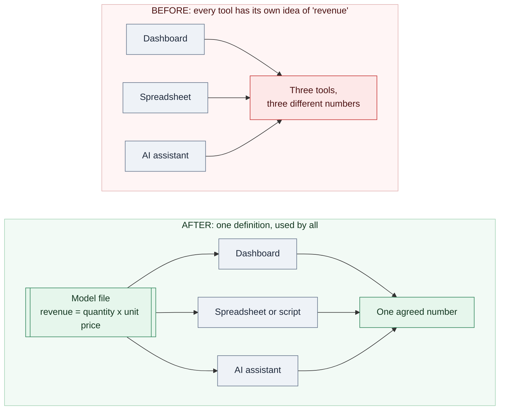
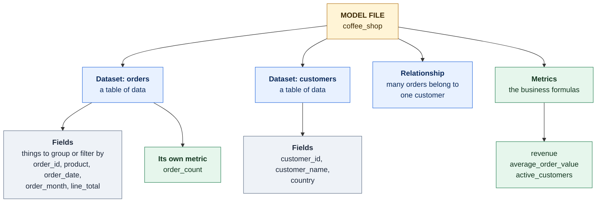
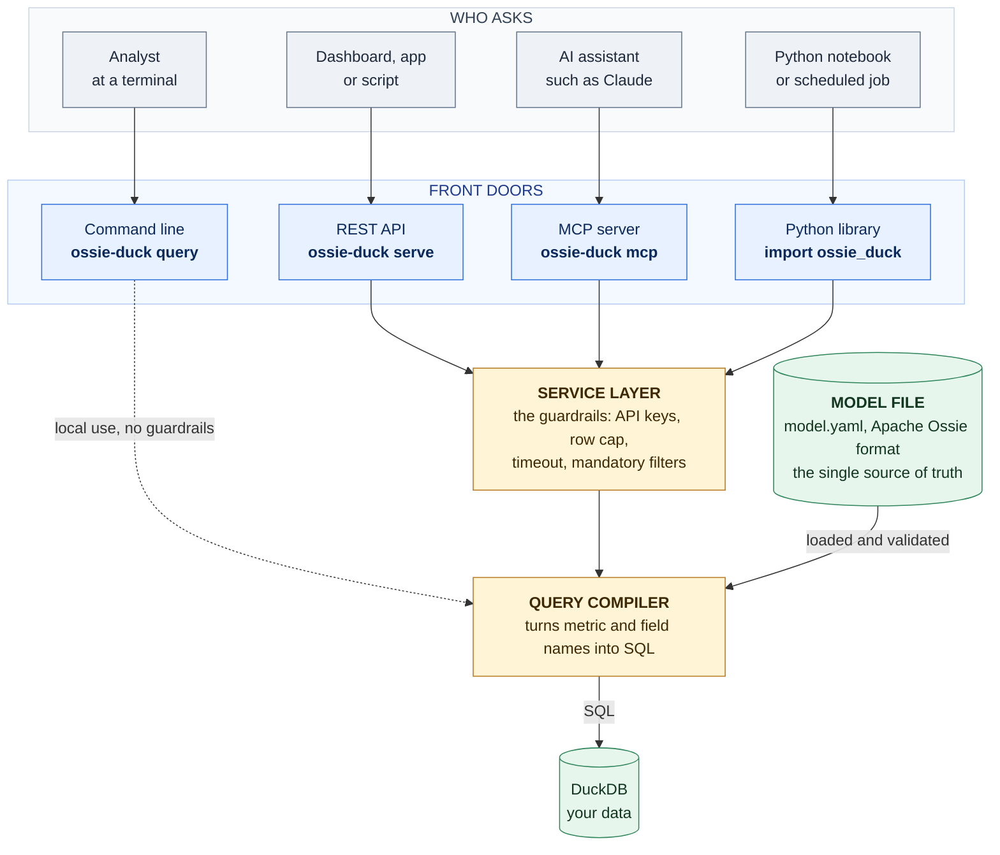
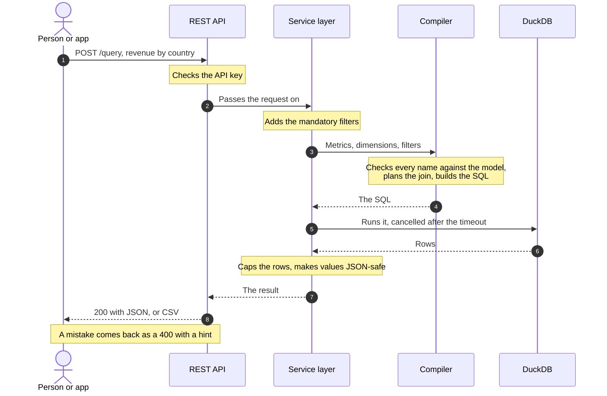
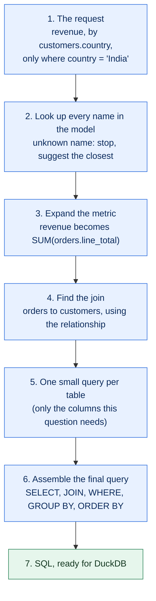
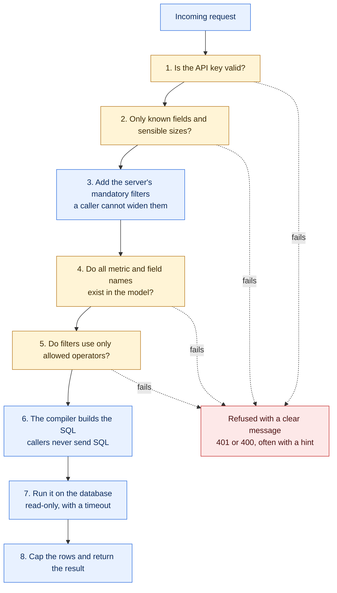

# ossie-duck

**Define your business numbers once. Use them everywhere.**

ossie-duck reads one file that says what your business terms mean ("revenue", "active customers", "average order value") and answers questions from it: from a terminal, from a dashboard, from a Python script, or from an AI assistant such as Claude. Everyone gets the same number, because everyone is using the same definition.

> **Status:** an independent learning project, not affiliated with or endorsed by the Apache Software Foundation. It implements the **draft** Apache Ossie spec version `0.2.0.dev0`, which may still change. For production use, look at the official tooling first (see [Limitations](#limitations-and-honest-caveats)).

## Contents

- [What is this? (plain English)](#what-is-this-plain-english)
- [Quickstart: 5 minutes, nothing else to install](#quickstart-5-minutes-nothing-else-to-install)
- [Hands-on: a coffee shop](#hands-on-a-coffee-shop)
- [Three ways to use it](#three-ways-to-use-it): [command line](#1-the-command-line), [REST API](#2-rest-api-for-dashboards-and-apps), [AI assistants](#3-ai-assistants-mcp), [Python](#4-from-python)
- [How it works (for the technically curious)](#how-it-works-for-the-technically-curious)
- [Writing your own model](#writing-your-own-model)
- [Reference](#reference) / [Troubleshooting](#troubleshooting) / [Glossary](#glossary)

---

## What is this? (plain English)

Picture three colleagues who are each asked for "last quarter's revenue". One includes tax. One leaves out refunds. One counts only paid orders. They come back with three different numbers, and the next meeting is spent arguing about which one is right.

A **semantic model** fixes this by writing the definition down once, in a file, in a standard format. Every tool then asks that file what "revenue" means instead of inventing its own answer.



*In words: without a shared definition, a dashboard, a spreadsheet and an AI assistant each calculate "revenue" their own way and disagree. With one model file, all three use the same formula and agree.*

The standard format is [Apache Ossie](https://ossie.apache.org) (formerly *Open Semantic Interchange*), an open specification backed by a number of data and BI vendors. **ossie-duck** is a small engine that reads an Ossie model and answers questions with it, using [DuckDB](https://duckdb.org), a fast database that runs on a laptop with nothing to install.

**Do I need to know SQL?** No. You name what you want (`revenue`, by `country`) and the tool works out the tables, the joins and the SQL.

### Who is this for?

| If you are... | You want to... | Start with |
|---|---|---|
| A business analyst | get numbers by name, with no SQL | [Quickstart](#quickstart-5-minutes-nothing-else-to-install), then [the command line](#1-the-command-line) |
| Building a dashboard or app | fetch numbers over HTTP | [REST API](#2-rest-api-for-dashboards-and-apps) |
| Using an AI assistant | ask in plain English and get answers based on your own definitions | [AI assistants](#3-ai-assistants-mcp) |
| A data engineer | keep definitions in git, validate them, use them from Python | [Writing your own model](#writing-your-own-model), [Python](#4-from-python) |

---

## Quickstart: 5 minutes, nothing else to install

**You need:** a terminal, `git`, and Python 3.10 or newer (check with `python --version`; on some systems the command is `python3`).

**1. Get the code**

```bash
git clone https://github.com/mani-bellan/claude-projects.git
cd claude-projects/ossie-duck
```

**2. Create an isolated Python environment and install**

```bash
python -m venv .venv
source .venv/bin/activate          # Windows PowerShell: .venv\Scripts\Activate.ps1
pip install -e ".[all]"
```

You will see `(.venv)` at the start of your prompt while the environment is active. (Windows: I have not tested on Windows; the commands above are the standard ones.)

**3. Run the demo**

```bash
ossie-duck demo
```

It runs three sample questions on a made-up retail store and prints the answers. The first one looks like this:

```
== Sales and profit by year
d_year  total_sales  total_profit
------  -----------  ------------
  2023   850,126.76    101,730.52
  2024   850,793.24    101,132.29
(2 rows)
```

The demo uses small **synthetic** data generated on the spot, so no real data is touched.

**4. Ask your own question**

```bash
ossie-duck list examples/tpcds_semantic_model.yaml        # what can I ask for?

ossie-duck query examples/tpcds_semantic_model.yaml --demo-data \
    -m total_sales -d item.i_category --order total_sales:desc --limit 3
```

```
i_category   total_sales
-----------  -----------
Electronics   351,716.62
Home          345,760.80
Music         340,106.74
(3 rows)
```

Read that command as: *"show me **m**etric `total_sales`, broken down by **d**imension `item.i_category`, biggest first, top 3."* Nothing else is needed.

---

## Hands-on: a coffee shop

The demo is a made-up store. Now try something you can read end to end: 24 orders from a small online coffee shop, in two CSV files. The business definitions live in one model file, [`examples/coffee_shop/coffee_shop_model.yaml`](examples/coffee_shop/coffee_shop_model.yaml).

A model is built from four kinds of thing:



*In words: a model file holds **datasets** (tables), **relationships** (how tables connect), and **metrics** (the business formulas). Each dataset lists its **fields**, the things you can group or filter by.*

Go to the example folder (all the commands below run from here):

```bash
cd examples/coffee_shop
```

**1. Build the little database from the CSV files**

```bash
python build_db.py
```

```
built .../examples/coffee_shop/coffee_shop.duckdb
```

**2. Check that the model is valid and can see the data**

```bash
ossie-duck validate coffee_shop_model.yaml --db coffee_shop.duckdb --rebind shop.public=main
```

```
coffee_shop_model.yaml: OK - model 'coffee_shop', 2 datasets, 1 relationships, 4 metrics
all dataset sources are readable
```

> **What is `--rebind shop.public=main`?** The model calls its tables `shop.public.orders` and `shop.public.customers`, a label that does not depend on where the data lives. `--rebind` tells the tool that in *your* database those tables are simply `main.orders` and `main.customers`. You will add it to every command.

**3. Ask questions**

```bash
ossie-duck query coffee_shop_model.yaml --db coffee_shop.duckdb --rebind shop.public=main \
    -m revenue -d customers.country --order revenue:desc
```

```
country  revenue
-------  -------
India     231.25
UK        184.75
USA       172.25
Germany   100.00
(4 rows)
```

Revenue lives in the `orders` table and country lives in the `customers` table. You never said how to connect them; the model's relationship told the tool.

```bash
ossie-duck query coffee_shop_model.yaml --db coffee_shop.duckdb --rebind shop.public=main \
    -m revenue,average_order_value -d orders.order_month
```

```
order_month  revenue  average_order_value
-----------  -------  -------------------
2026-01       217.75              27.2188
2026-02       212.75              26.5938
2026-03       257.75              32.2188
(3 rows)
```

```bash
ossie-duck query coffee_shop_model.yaml --db coffee_shop.duckdb --rebind shop.public=main \
    -m revenue,orders.order_count -d orders.product -f "customers.country = 'India'" \
    --order revenue:desc --limit 3
```

```
product         revenue  order_count
--------------  -------  -----------
Espresso Beans   129.50            4
Cold Brew Kit     48.00            2
Green Tea         29.25            1
(3 rows)
```

**4. Change a definition and watch every answer change**

This is the point of the whole project. Suppose the owner decides revenue should **not count mugs**. Open `coffee_shop_model.yaml` in any text editor and find the `revenue` metric:

```yaml
  - name: revenue
    expression: { sql: SUM(orders.line_total) }
```

Replace the second line with:

```yaml
    expression: { sql: "SUM(CASE WHEN orders.product <> 'Ceramic Mug' THEN orders.line_total ELSE 0 END)" }
```

Save, and run the first query again:

```
country  revenue
-------  -------
India     219.25
UK        172.75
USA       124.25
Germany    64.00
(4 rows)
```

Every number dropped by exactly the mug sales, and that one edit is the only change. The REST API and MCP server read the model when they start, so restart a running one to pick it up; after that they give the new numbers too. To undo the edit: `git checkout coffee_shop_model.yaml`.

---

## Three ways to use it

All of them read the same model file and give the same answers. Pick the one that fits who is asking.

| | Best for | Command |
|---|---|---|
| [1. Command line](#1-the-command-line) | analysts, quick checks, scripts | `ossie-duck query ...` |
| [2. REST API](#2-rest-api-for-dashboards-and-apps) | dashboards, apps, anything that speaks HTTP | `ossie-duck serve ...` |
| [3. AI assistants (MCP)](#3-ai-assistants-mcp) | asking questions in plain English | `ossie-duck mcp ...` |
| [4. Python](#4-from-python) | notebooks, scheduled jobs | `import ossie_duck` |

### 1. The command line

You have already used it. The commands:

| Command | What it does |
|---|---|
| `ossie-duck list MODEL` | show every metric and field you can ask for |
| `ossie-duck validate MODEL` | check a model file for mistakes |
| `ossie-duck query MODEL -m ... -d ... -f ...` | run a question and print the answer (add `--format csv` or `json`, and `--show-sql` to see the SQL) |
| `ossie-duck sql MODEL -m ... -d ...` | show the SQL without running it |

### 2. REST API for dashboards and apps

A REST API lets other programs ask questions over HTTP, which is how most dashboards and web apps talk to a data service.

Open **two terminals** in `examples/coffee_shop` (with the environment active).

**Terminal 1: start the server**

```bash
export OSSIE_DUCK_API_KEYS="my-secret-key-12345"          # Windows PowerShell: $env:OSSIE_DUCK_API_KEYS="my-secret-key-12345"
ossie-duck serve coffee_shop_model.yaml --db coffee_shop.duckdb --rebind shop.public=main
```

```
REST API (docs at /docs) for model 'coffee_shop' on http://127.0.0.1:8000 - API key required (1 configured); max 1000 rows, 30s timeout
```

The key is a password for the API. Use a long random one for anything real: `python -c "import secrets; print(secrets.token_urlsafe(32))"`. It must be at least 16 characters.

**Terminal 2: ask it things** (on Windows PowerShell use `curl.exe`, because plain `curl` is a different command there)

```bash
# What can I ask for?
curl -H "Authorization: Bearer my-secret-key-12345" http://127.0.0.1:8000/catalog

# Revenue by country
curl -H "Authorization: Bearer my-secret-key-12345" -H "Content-Type: application/json" \
     http://127.0.0.1:8000/query \
     -d '{"metrics": ["revenue"], "dimensions": ["customers.country"], "order_by": ["revenue:desc"]}'
```

```json
{"columns":["country","revenue"],"rows":[["India",231.25],["UK",184.75],["USA",172.25],["Germany",100.0]],"row_count":4,"truncated":false,"max_rows":1000,"warnings":[]}
```

Spreadsheets and BI tools that import by URL can use the CSV form (the tool must be able to send the key as a header; ones that cannot only work against a server run without a key on your own machine):

```bash
curl -H "Authorization: Bearer my-secret-key-12345" \
     "http://127.0.0.1:8000/query?metric=revenue&metric=average_order_value&dimension=orders.order_month&format=csv"
```

```
order_month,revenue,average_order_value
2026-01,217.75,27.21875
2026-02,212.75,26.59375
2026-03,257.75,32.21875
```

Without the key you get `401`; with a typo you get a helpful `400`:

```
{"error": "missing or invalid API key"}
{"error":"unknown metric 'revenu'. Did you mean: revenue?"}
```

**Want to click around instead?** Stop the server, start it again *without* setting `OSSIE_DUCK_API_KEYS`, and open <http://127.0.0.1:8000/docs> in a browser for an interactive page. Without a key the server only accepts connections from your own computer, which is why this is allowed. (A browser cannot send the key header, so the page does not work with a key set.)

<details>
<summary>All endpoints and options</summary>

| Endpoint | Purpose |
|---|---|
| `GET /health` | is it running? (the only endpoint without a key) |
| `GET /catalog` | metrics, fields (type, time flag, description, synonyms), relationships, limits |
| `POST /query` | JSON body `{metrics, dimensions, filters, order_by, limit, include_sql}`; add `?format=csv` for CSV |
| `GET /query` | the same through URL parameters `metric`, `dimension`, `filter`, `order` (repeat them), `limit`, `format`, `include_sql` |
| `POST /sql` | compile only; returns the SQL |
| `GET /docs` | interactive OpenAPI page |

Server options: `--host` (default `127.0.0.1`), `--port` (default 8000), `--max-rows`, `--timeout`, `--base-filter`, `--cors-origin`. Keys are accepted as `Authorization: Bearer KEY` or `X-API-Key: KEY`, never in the URL. DECIMAL values come back as floats, so very large or very precise decimals can lose precision.

</details>

### 3. AI assistants (MCP)

**MCP** (Model Context Protocol) is a standard "plug" that lets AI assistants such as Claude use outside tools. ossie-duck offers three read-only tools to the assistant:

| Tool | What the assistant uses it for |
|---|---|
| `describe_model` | learn which metrics and fields exist, and what they mean |
| `semantic_query` | compute metrics, grouped and filtered |
| `explain_query` | show the SQL without running it |

The assistant never writes SQL. It picks names from your model, so "revenue" always means *your* revenue. If it picks a wrong name, it gets back "Did you mean: revenue?" and tries again.

**Connect Claude Desktop.** Add this to `claude_desktop_config.json`, replacing the paths with the **absolute** paths on your machine (run `pwd` in the project folder to see it; on Windows the command is `...\.venv\Scripts\ossie-duck.exe`):

```json
{
  "mcpServers": {
    "coffee-shop": {
      "command": "/ABSOLUTE/PATH/TO/ossie-duck/.venv/bin/ossie-duck",
      "args": [
        "mcp",
        "/ABSOLUTE/PATH/TO/ossie-duck/examples/coffee_shop/coffee_shop_model.yaml",
        "--db", "/ABSOLUTE/PATH/TO/ossie-duck/examples/coffee_shop/coffee_shop.duckdb",
        "--rebind", "shop.public=main"
      ]
    }
  }
}
```

**Connect Claude Code** with one command:

```bash
claude mcp add coffee-shop -- /ABSOLUTE/PATH/TO/ossie-duck/.venv/bin/ossie-duck mcp \
    /ABSOLUTE/PATH/TO/ossie-duck/examples/coffee_shop/coffee_shop_model.yaml \
    --db /ABSOLUTE/PATH/TO/ossie-duck/examples/coffee_shop/coffee_shop.duckdb --rebind shop.public=main
```

Then ask in plain English: *"What was revenue by country?"*, *"Which product sells best in India?"*, *"Show me monthly revenue and average order value."*

> **Honest note:** I tested the MCP server with the MCP SDK's own client (over stdio and over HTTP, as real separate processes). I have **not** tested these exact configurations inside Claude Desktop or Claude Code, so if a setting differs in your version, the client's MCP documentation is the authority on the config format.

**Is it safe to point an AI at my data?** The assistant can only run read-only questions built from your model's metrics and fields; it cannot send SQL, change data, or return more than the row cap. But it can read anything your model exposes, so model only what you are comfortable sharing. See [guardrails](#guardrails).

There is also an HTTP version for remote use: `ossie-duck mcp MODEL --transport http --port 8001`. It requires `OSSIE_DUCK_API_KEYS` unless it listens on your own machine only.

### 4. From Python

```python
import duckdb
from ossie_duck import SemanticService, load_model

model = load_model("coffee_shop_model.yaml")
service = SemanticService(
    model,
    duckdb.connect("coffee_shop.duckdb", read_only=True),
    rebind={"shop.public": "main"},
)

result = service.query({
    "metrics": ["revenue"],
    "dimensions": ["customers.country"],
    "order_by": ["revenue:desc"],
})
print(result["rows"])   # [['India', 231.25], ['UK', 184.75], ['USA', 172.25], ['Germany', 100.0]]
```

`SemanticService` applies the same limits and filters as the REST API and MCP server. For raw access, `Engine` and `compile_query` are also exported.

---

## How it works (for the technically curious)

### The big picture



*In words: people and programs come in through one of four front doors. The REST API, MCP server and Python library all pass through one **service layer** that enforces the guardrails (the command line is for local use and skips it). The service layer hands the request to the **query compiler**, which reads the **model file** and writes SQL. DuckDB runs the SQL on your data.*

| Layer | File | Job |
|---|---|---|
| Model loader | `model.py` | read the YAML/JSON, validate it against the Ossie JSON Schema, then check the rules a schema cannot express (unique names, relationship targets, metric scoping) |
| Query compiler | `compiler.py` | turn metric, dimension and filter names into SQL |
| Engine | `engine.py` | run compiled SQL on DuckDB (used by the command line) |
| Service layer | `service.py` | the guardrails, plus JSON-safe results and the catalog (used by REST, MCP and Python) |
| REST API | `rest.py` | FastAPI app |
| MCP server | `mcp_server.py` | tools and a catalog resource for AI agents |
| Auth | `auth.py` | API-key middleware shared by REST and MCP-over-HTTP |
| Natural language | `ask.py` | optional: a model picks metrics and fields from a question (it never writes SQL) |

### Life of one request



*In words: a request arrives, the key is checked, mandatory filters are added, the compiler validates every name and writes the SQL, DuckDB runs it with a time limit, and the service caps the rows and returns JSON. A mistake at any point comes back as a clear error.*

### From a question to SQL



*In words: look up each name in the model, expand the metric into its formula, find how the tables connect, build one small query per table, then assemble the final query.*

For `revenue` by `customers.country`, filtered to India, the compiler produces:

```sql
WITH
  "__orders" AS (
    SELECT
      customer_id AS "customer_id",
      quantity * unit_price AS "line_total"
    FROM "main"."orders"
  ),
  "__customers" AS (
    SELECT
      customer_id AS "customer_id",
      country AS "country"
    FROM "main"."customers"
  )
SELECT
  "customers"."country" AS "country",
  SUM("orders"."line_total") AS "revenue"
FROM "__orders" AS "orders"
LEFT JOIN "__customers" AS "customers" ON "orders"."customer_id" = "customers"."customer_id"
WHERE ("customers"."country" = 'India')
GROUP BY 1
ORDER BY 1
```

Why it is built this way:

- **Fields are a dataset's public interface.** The Ossie spec says metrics reference *fields*, not raw columns. So each dataset becomes a small query (a CTE) that exposes only the fields this question needs, and the metric formula `SUM(orders.line_total)` runs unchanged on top.
- **Joins start at the "many" side.** A relationship says "many orders, one customer", so the compiler picks a root table that can reach every other table needed and joins toward the "one" side. That way joins never multiply rows.
- **`LEFT JOIN`**, so facts with no matching dimension row still count (they appear under `NULL`).
- **Warnings instead of silent wrong answers.** If a metric adds up a field from the "one" side (for example summing store employees across sales rows), it would be counted once per sale, so the tool warns that it may be overcounted.

### Guardrails



*In words: every request passes a series of checks before any SQL runs, and a failure at any check ends in a clear message.*

| | |
|---|---|
| **No SQL from callers** | requests name metrics and fields; the compiler builds the query. Filters may use only comparisons, `IN`, `BETWEEN`, `LIKE`, `IS NULL`, `AND`/`OR`/`NOT` and literal values. Unknown request fields are refused. |
| `--max-rows N` (default 1000) | rows beyond the cap are not returned; the response says `truncated: true` and adds a warning |
| `--timeout S` (default 30) | a running query is cancelled after S seconds |
| `--base-filter F` (repeatable) | a condition added to **every** query, so a server can be scoped, for example to one region. A caller's own `OR` cannot widen it. Validated at startup. |
| API keys | in `OSSIE_DUCK_API_KEYS` (comma-separated, 16+ characters each); checked in constant time; never read from the command line or the URL |
| Network binding | listening on anything but `127.0.0.1` is refused unless keys are set |
| Read-only data | a database passed with `--db` is opened read-only |
| CSV safety | text cells starting with `=`, `+`, `-` or `@` get a leading `'` so spreadsheets will not run them as formulas |
| Errors | callers see only errors they can act on; internal failures return a generic message and are logged on the server |

**What this does not give you:** all keys have the same access (run one server per audience if scopes differ); there is no TLS (put it behind a reverse proxy if it leaves your machine); there is no rate limiting.

---

## Writing your own model

Copy [`examples/coffee_shop/coffee_shop_model.yaml`](examples/coffee_shop/coffee_shop_model.yaml) and edit it. The pieces, in the order you will write them:

1. **`version`** must be `"0.2.0.dev0"`, and **`name`** is your model's name. `ai_context.instructions` is free text that AI assistants are shown.
2. **`datasets`**: one per table. Give each a `source` (the table name, like `shop.public.orders`) and a list of **`fields`**. A field is a column or a computed value (`quantity * unit_price`). Add `description` and `ai_context.synonyms` (other words people use); assistants rely on them to pick the right name.
3. **`relationships`**: for each foreign key, `from` the "many" dataset `to` the "one" dataset, with `from_columns` and `to_columns` (these are *field* names, not raw column names).
4. **`metrics`**: your business formulas, written with aggregates. Two kinds:
   - **model-level** (the top-level `metrics:` list) refer to fields as `dataset.field`, and may combine several datasets: `SUM(orders.line_total) / COUNT(DISTINCT orders.order_id)`
   - **dataset-level** (inside a dataset) refer to that dataset's own fields as plain names and are asked for as `dataset.metric`: `COUNT(order_id)`
5. Run **`ossie-duck validate your_model.yaml`** after every change. It tells you what is wrong.

Common validation messages:

| Message | What it means |
|---|---|
| `metric revenue: 'line_totl' is not a declared field of dataset 'orders'` | a typo, or the field is missing from that dataset's `fields` |
| `dataset-scoped metric references customers.customer_id; a metric that spans datasets belongs in the model-root metrics` | a metric inside one dataset used another dataset's field; move it to the top-level `metrics:` |
| `version: document declares version '0.1.1'; this tool implements '0.2.0.dev0'` | the file is written for a different version of the spec |

The model format is defined by the open spec: [`core-spec/spec.md`](https://github.com/apache/ossie/blob/main/core-spec/spec.md) in the Apache Ossie repository.

---

## Reference

<details>
<summary>Every command</summary>

| Command | What it does |
|---|---|
| `validate MODEL [--db F \| --demo-data] [--rebind P=T]` | schema and semantic checks; with `--db`, also checks every dataset's table is readable |
| `list MODEL` | metrics, fields (type, time flag, description) and relationships |
| `sql MODEL -m ... -d ... -f ...` | compile only |
| `query MODEL ... [--db F \| --demo-data] [--format table\|csv\|json] [--show-sql]` | compile and run |
| `serve MODEL [--host H] [--port P] [--max-rows N] [--timeout S] [--base-filter F] [--cors-origin O]` | REST API |
| `mcp MODEL [--transport stdio\|http] [--host H] [--port P]` plus the limits above | MCP server |
| `ask MODEL "question"` | plain-English question (needs the `ai` extra and `ANTHROPIC_API_KEY`) |
| `demo [MODEL] [--tpcds-extension]` | sample queries; `--tpcds-extension` uses DuckDB's own TPC-DS generator (needs the internet once) |

`-m`, `-d` and `-f` can be repeated or comma-separated. Metrics are written `metric` (model-level) or `dataset.metric`; dimensions are `dataset.field` (a bare field name works when only one dataset has it). `--order COLUMN[:desc]` sorts and `--limit N` trims.

Install extras: `".[serve]"` (REST), `".[mcp]"` (MCP, needs the `mcp` 2.x SDK), `".[ai]"` (the `ask` command), `".[all]"` (all three), `".[dev]"` (everything the tests need).

`ask` sends the model's catalog (names, descriptions, synonyms) to Claude and lets it choose metrics and fields. The choice goes through the same validation as any query. Set `OSSIE_DUCK_MODEL` to change the Claude model. Credentials live in your environment (see `.env.example`), never in this repository.

</details>

## Troubleshooting

| You see | Why, and what to do |
|---|---|
| `command not found: ossie-duck` | the environment is not active. Run `source .venv/bin/activate` (Windows: `.venv\Scripts\Activate.ps1`) from the `ossie-duck` folder |
| `error: database file not found: coffee_shop.duckdb` | you have not built it yet, or you are in the wrong folder. Run `python build_db.py` inside `examples/coffee_shop` |
| `Catalog Error: Table with name "shop.public.orders" does not exist` | add `--rebind shop.public=main` (the error prints this hint for your model) |
| `unknown metric 'revenu'. Did you mean: revenue?` | a typo. Run `ossie-duck list MODEL` to see every valid name |
| `warning: metric '...' aggregates fields of ... and may be overcounted` | the metric adds up a value from the "one" side of a join once per row on the "many" side. Group by that table's own fields, or define the metric on that table |
| `error: this command needs fastapi: pip install 'ossie-duck[serve]'` | install the extra: `pip install -e ".[all]"` |
| `refusing to listen on 0.0.0.0 without authentication` | set `OSSIE_DUCK_API_KEYS`, or use `--host 127.0.0.1` |
| `401 missing or invalid API key` | send `Authorization: Bearer YOUR_KEY` or `X-API-Key: YOUR_KEY`, with the same key the server was started with |
| `Address already in use` | another program is using the port. Choose another with `--port 8010` |
| `the result was cut off at 1000 rows` | add filters or `limit`, or raise `--max-rows` |

## Glossary

| Term | Plain meaning |
|---|---|
| **Semantic model** | a file that defines your business terms and how your data fits together |
| **Metric** | a business number, defined by a formula: a total, a count, a ratio (`revenue`) |
| **Dimension / field** | something you can group or filter by (`country`, `product`, `order_month`) |
| **Dataset** | one table of data in the model (`orders`) |
| **Relationship** | how two datasets connect (each order belongs to one customer) |
| **Filter** | a condition that limits the data (`country = 'India'`) |
| **Apache Ossie** | the open standard format for semantic models (formerly Open Semantic Interchange) |
| **DuckDB** | a fast database that runs inside your program, with no server to set up |
| **SQL** | the standard language for asking databases questions; this tool writes it for you |
| **REST API** | a way for programs to ask another program questions over HTTP |
| **API key** | a password that a program sends to prove it is allowed in |
| **MCP** | Model Context Protocol: a standard plug that lets AI assistants use tools |

## Limitations and honest caveats

- **One fact table per question.** Questions that combine several fact tables, and ambiguous join paths (two relationships between the same datasets), give a clear error rather than a guess.
- **Learning-sized.** It has 180 automated tests that compare results with hand-written SQL, and the servers were checked as real processes, but it is not load-tested. For production, look at the official Apache Ossie tooling and DuckDB's community `ossie` extension (`INSTALL ossie FROM community`).
- **Draft spec.** It implements `0.2.0.dev0` only and rejects other versions with a clear message.
- **Dialects.** Expressions in `OSSIE_SQL_2026`, `ANSI_SQL` and `DUCKDB` run as-is on DuckDB. A field or metric that only has another dialect (such as `SNOWFLAKE`) is reported and skipped, and only fails if a question uses it.
- **Not supported by the spec version yet:** fields that refer to other fields, metrics that refer to other metrics, datasets built from other datasets. `custom_extensions` are carried but not interpreted.
- **Trusted model files.** A dataset `source` that is a SQL query is inserted as written, so only load models you trust.

## Development

```bash
pip install -e ".[dev]"
pytest
```

The tests compare engine output with hand-written SQL on synthetic data, recompute every number in the coffee-shop walkthrough from the raw CSV files, drive the REST API and the MCP server through their real protocols, and run the `ask` loop with a fake client, so no network or API key is needed.

## Project layout

```
ossie-duck/
  src/ossie_duck/
    model.py       load, validate and index a model
    compiler.py    metric/dimension/filter names to DuckDB SQL
    engine.py      run compiled queries
    service.py     guardrails, catalog, JSON-safe results
    rest.py        REST API (FastAPI)
    mcp_server.py  MCP server
    auth.py        API-key middleware
    ask.py         optional natural-language layer
    cli.py         the ossie-duck command
    sample_data.py synthetic TPC-DS tables, TPC-DS extension loader
    schema/        ossie-schema.json (from apache/ossie, spec 0.2.0.dev0)
  examples/
    coffee_shop/   the walkthrough: CSVs, build_db.py, coffee_shop_model.yaml
    tpcds_semantic_model.yaml   official Apache Ossie example
  tests/
```

## License and credits

Apache License 2.0 (see `LICENSE`). `NOTICE` lists the two files taken unmodified from [Apache Ossie](https://github.com/apache/ossie): the JSON schema and the TPC-DS example model. Apache Ossie is a project of the Apache Software Foundation (incubating); this project is independent of it.
